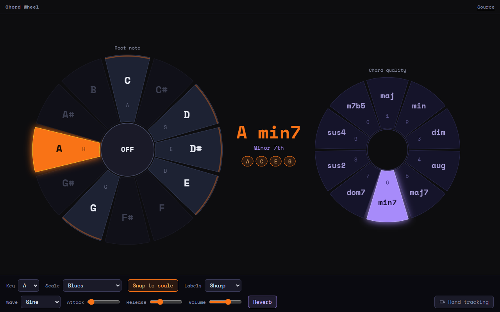

# Chord Wheel

[](https://github.com/nguyenhanhatminh0105-hue/Chord-Wheel/actions/workflows/tests.yml)

**[Live demo](https://nguyenhanhatminh0105-hue.github.io/Chord-Wheel/)**: runs in the browser, nothing to install.

Explore and play chords on two wheels: one picks the root note, the other the chord quality. Play with the mouse, the computer keyboard, or your hands in front of a webcam (tracked with MediaPipe). It runs as an Electron desktop app and, from the same files, as a web page.



## Features

- **Interactive chord wheel** — hold any slice to play a chord, and change the quality while it sounds
- **Keyboard** — `A` to `J` play the twelve notes (home row for white keys, the row above for black), `1` to `0` pick the quality
- **Hand tracking** — optional webcam mode using MediaPipe; left hand picks the note, right hand the quality
- **12 keys, 9 scales** — Major, Minor, Pentatonic, Blues, Dorian, Phrygian, Lydian, Mixolydian, Harmonic Minor. Notes in the scale are marked on the wheel
- **10 chord qualities** — maj, min, dim, aug, maj7, min7, dom7, sus2, sus4, m7b5
- **Built-in synthesizer** — sine, triangle, sawtooth, or square wave with attack/release envelope
- **Reverb** and **volume** controls
- **Note labeling** — Sharp, Flat, or Solfège
- **Snap mode** — lock to scale tones only

## Getting Started

```bash
npm install
npm start
```

Requires Node.js and a webcam (optional, for hand tracking).

On Windows, `launch.vbs` (which calls `launch.bat`) offers a double-click, no-terminal way to start the app once the repo path inside `launch.bat` is updated to match your local checkout.

## Web version

`index.html` needs no build step and no Electron: serve the folder and open it.

```bash
npx http-server .
```

In a browser the hand-tracking model is loaded from a CDN the first time the camera is switched on. In Electron it is read from `node_modules`.

## Tests

The music theory (note names, scales, chord spelling and pitch) lives in `theory.js`, apart from the audio and drawing code in `renderer.js`, so it runs under plain Node:

```bash
npm test
```
